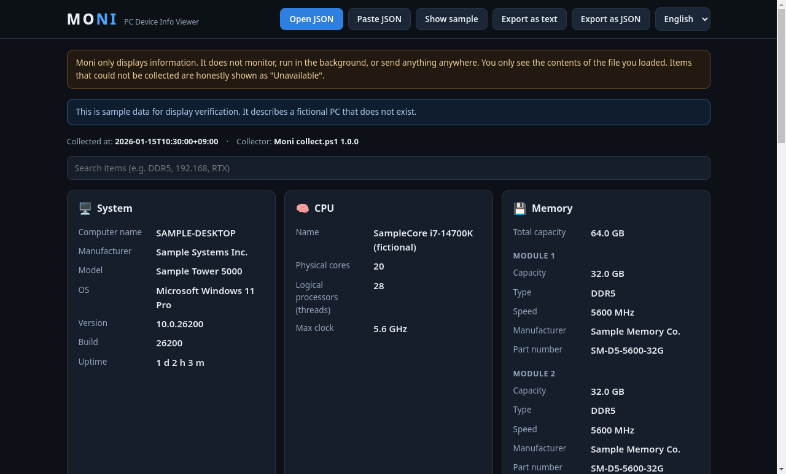

# Moni — PC デバイス情報ビューア

Moni は、**PC のデバイス情報を「見る」ことに特化した**ビューアです。
お使いの PC で情報収集スクリプトを実行すると `moni-report.json` が作られ、それを単一 HTML のビューアで開くと、カテゴリ別に読みやすく表示できます。

> 住み分け: **Moni はデバイス情報の閲覧専門**です。BIOS の更新管理は姉妹ツール [BIOSMAN](https://github.com/shizukutanaka/BIOSMAN) の役割です。

## 使い方（3ステップ）

1. **集める** — Windows の場合は `collect.bat` をダウンロードしてダブルクリック、Linux の場合は `collect.sh` をダウンロードして実行（`chmod +x collect.sh` のうえで `./collect.sh`）します。どちらの場合も PC のデバイス情報を集めて、同じ場所に `moni-report.json` を出力します（管理者権限は不要です）。
2. **開く** — `index.html` をブラウザで開き、「JSON を開く」から `moni-report.json` を選びます。ドラッグ＆ドロップや、内容の貼り付けでも読み込めます。
3. **見る** — カテゴリ別のカードで情報を確認します。項目の検索、テキスト / JSON での書き出し、2つのレポートの比較、相談用の共有書き出しもできます。

まず見た目だけ確認したい場合は、ビューアの「サンプルを表示」を押してください。実在しない架空の PC のサンプルデータが表示されます（`sample-report.json`）。

## 表示できる情報

- **システム概要**: コンピュータ名、メーカー / モデル、OS 名・バージョン・ビルド、稼働時間
- **CPU**: 名前、物理コア数、論理プロセッサ数、最大クロック
- **メモリ**: 総容量と、モジュール別の容量・規格（DDR4 / DDR5 など）・速度・メーカー・型番
- **GPU**: 名前、VRAM、ドライババージョン
- **マザーボード**: メーカー、製品名、BIOS バージョン・日付
- **ストレージ**: 物理ディスク（モデル・容量・種別・接続方式）と論理ドライブ（総容量・空き・使用率）
- **ネットワーク**: アダプタ名、IP アドレス（v4 / v6）、MAC アドレス、リンク速度、状態
- **ディスプレイ**: 解像度、リフレッシュレート
- **バッテリー**: 充電率、状態、設計容量・満充電容量と健全性（バッテリーが無い PC では「なし」と表示します）
- **USB / 周辺デバイス**: 接続中のデバイス一覧

取れなかった項目は、**推測で埋めずに「取得不可」と表示**します。

## レポートの比較

レポートを開いた状態で「レポートを比較」からもう1つのレポートを選ぶと、2つのレポートの違いを一覧できます。前回 / 今回は収集日時で自動的に判定します。

- 変わった項目はカテゴリ別に「変更（旧値 → 新値）」「追加」「削除」で示します。デバイスが丸ごと増えた / 減った場合は、そのデバイスを1件として数えます。
- 変わっていない項目は件数だけを示し、開くと一覧できます。
- **比較対象外**（デバイスの変更ではなく、その時々で変わる値）: 収集日時、稼働時間、ドライブの空き容量、バッテリーの充電率と状態、ネットワークの接続状態。これらは画面上にも明記しています。
- 比較はこの端末の中だけで行い、レポートの形式（`moni-report.json`）は変更しません。

## 共有用書き出し（相談用）

詳しい人に見せて相談するために、「共有用に書き出し」から相談用のコピーを作れます。ファイルはこの端末の中で作られ、どこにも送信されません。保存先はあなたが選びます。

- **既定では、個人を特定しうる項目を伏せます**: コンピュータ名、MAC アドレス、IP アドレス（IPv4 / IPv6）。伏せた項目は `(masked)` に置き換わり、伏せた項目の一覧は書き出し画面とテキスト書き出しの冒頭に明示されます。取得できなかった項目（null）は伏せ字に変えず、そのまま「取得不可」として残します（データを捏造しません）。
- 伏せない書き出しも選べます。その場合は、元の値のまま含まれる項目（コンピュータ名、MAC アドレス、IP アドレス）を画面に明示してから書き出します。
- **伏せ字の対象外**: ドライブのラベルやデバイス名など、自由な文字列が入る項目は伏せません（名前に個人名などを付けている場合は、共有前に内容を確認してください）。

## やらないこと

Moni は「見る」だけのツールです。以下は意図的に行いません。

- 監視・常駐・定期収集（バックグラウンドで動き続けません）
- 外部への送信（収集スクリプトもビューアも、ネットワーク通信を一切しません）
- PC の設定変更（収集は読み取り専用です）
- データの外部保管（データはあなたの端末の中だけにあります。作成者があなたのデータを預かる仕組みはありません）

## 構成

| ファイル | 役割 |
| --- | --- |
| `index.html` | ビューア本体。単一ファイル、外部依存ゼロ、オフライン動作、日本語 / 英語切替。レポート比較と共有用（マスク付き）書き出しもここに含む |
| `collect.ps1` | Windows 用の情報収集スクリプト（CIM/WMI で読み取り、`moni-report.json` を出力） |
| `collect.bat` | `collect.ps1` の起動用バッチ |
| `collect.sh` | Linux 用の情報収集スクリプト（`/proc`・`/sys` と標準コマンドで読み取り、同じ形式の `moni-report.json` を出力。追加のソフトは不要） |
| `sample-report.json` | 表示確認用のサンプル（実在しない架空の PC のデータ） |
| `tests/` | スキーマ検証（`validate.js`）と、Electron による実 UI 検証（`ui-test/`） |

## 検証状況

- スキーマ検証とビューアの実 UI 検証（Electron + Xvfb）は開発環境で実施し、全項目合格しています。実 UI 検証には、レポート比較（変更検出・対象外項目の除外・パネル表示）と共有用書き出し（マスク適用・元データ不変・既定でマスク側）の確認も含まれます。
- **Linux での `collect.sh` の実行は開発環境（Linux）で検証済みです。** スキーマ検証（`tests/validate.js`）は Linux 上では収集スクリプトを実際に実行し、生成されたレポートがスキーマに適合することまで確認します。生成レポートをビューアで開く確認も行いました。
- **Windows 実機での `collect.ps1` / `collect.bat` の実行は未検証です。** 初回実行がそのまま初試験になります。うまく取れなかった項目は「取得不可」と表示される設計で、PC に変更を加えることはありません。
- Linux では環境によって次の項目が「取得不可」になりやすいです: メモリモジュールの詳細（`dmidecode` が必要で、多くの場合は管理者権限も必要です）、GPU の VRAM とドライババージョン（ドライバや取得手段に依存します）、ディスプレイのリフレッシュレート（X 環境で `xrandr` が使える場合のみ）、マザーボード情報（仮想マシンではファームウェア情報自体が無い場合があります）。
- VRAM の容量は、取得方法（レジストリ値 / WMI）の都合で概算になる場合があります。ディスプレイ情報はビデオコントローラ単位の取得のため、複数モニタ環境では表示と一致しない場合があります。

## ライセンス

MIT License
